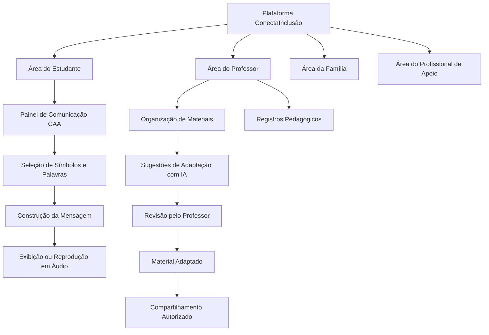

# Modelagem e Fluxos da Plataforma Mosaico

## 1. Apresentação

Este documento apresenta a representação geral do funcionamento da plataforma ConectaInclusão, demonstrando como os diferentes perfis de usuários interagem com as principais funcionalidades.

A modelagem considera três áreas centrais: comunicação assistiva, apoio pedagógico e acompanhamento educacional.

## 2. Diagrama geral de funcionamento

O diagrama apresenta os principais módulos da plataforma e suas relações.

O diagrama representa a organização conceitual da plataforma. A disponibilidade das informações para familiares e profissionais de apoio deverá respeitar as permissões de acesso.

## 3. Fluxo de interação do estudante

O fluxo de interação do estudante será direcionado à utilização dos recursos de comunicação alternativa.

1. Acessar a área do estudante.
2. Abrir o painel de comunicação.
3. Visualizar os símbolos, imagens e palavras disponíveis.
4. Selecionar os elementos desejados.
5. Construir uma mensagem.
6. Visualizar ou reproduzir a mensagem em áudio.
7. Compartilhar a mensagem com o educador, quando necessário.

## 4. Fluxo de interação do professor

O fluxo do professor será direcionado à organização e adaptação dos materiais pedagógicos.

1. Acessar a área do educador.
2. Selecionar ou adicionar um material pedagógico.
3. Escolher a opção de adaptação do conteúdo.
4. Receber sugestões geradas com auxílio de inteligência artificial.
5. Analisar, revisar e modificar o conteúdo.
6. Aprovar a versão adaptada.
7. Compartilhar o material com o estudante autorizado.
8. Registrar observações sobre a atividade pedagógica.

## 5. Fluxo de acompanhamento

O acompanhamento permitirá compartilhar informações educacionais entre a escola, a família e os profissionais de apoio autorizados.

1. O professor registra uma atualização pedagógica.
2. Seleciona as pessoas autorizadas a receber a informação.
3. A plataforma disponibiliza a atualização aos destinatários.
4. A família ou o profissional autorizado acessa o conteúdo.
5. As informações ficam organizadas para consulta conforme as permissões estabelecidas.

## 6. Observações da modelagem

Os diagramas e fluxos representam o funcionamento planejado da solução e poderão ser atualizados conforme o desenvolvimento do protótipo.

A plataforma deverá manter a revisão humana nas adaptações pedagógicas e limitar o compartilhamento de informações aos usuários autorizados.
